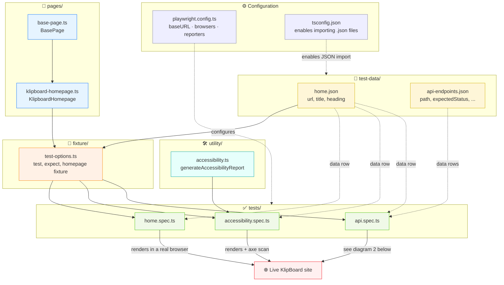
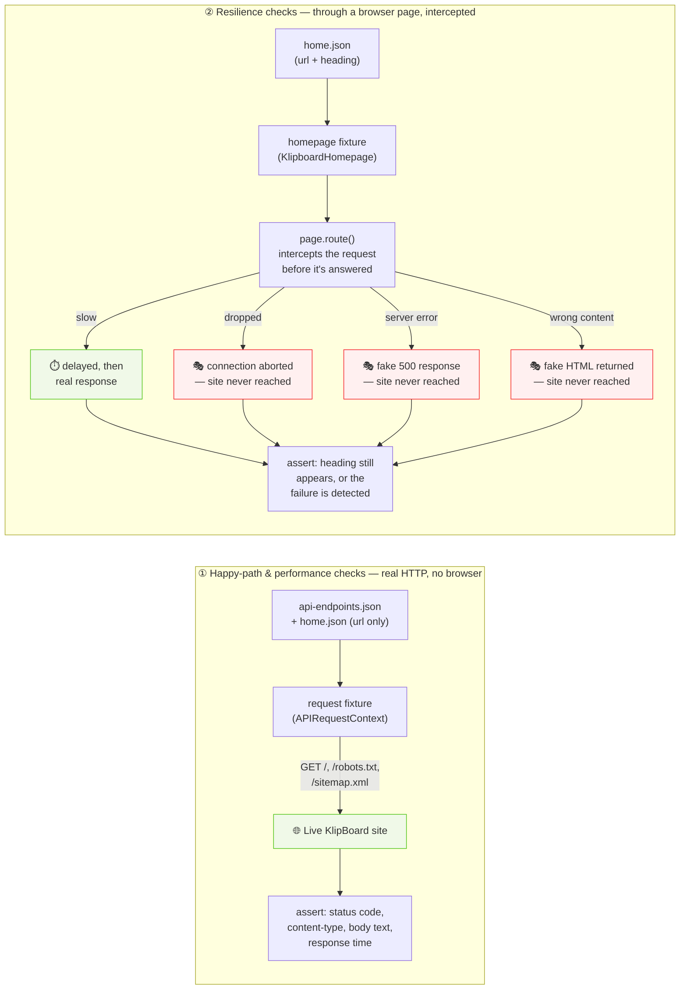

# Wiremap — How the project fits together

A map of how every file in this project connects, from test data through to the live KlipBoard site. GitHub renders the diagrams below automatically.

## 1. Overall architecture

Every spec in `tests/` is built the same way: data flows up from `test-data/`, through `pages/` and `fixture/`, into the spec. `playwright.config.ts` and `tsconfig.json` are cross-cutting — they configure/enable everything below them rather than being imported directly.

## 2. `api.spec.ts` is different — it has two separate paths

Every other spec only ever talks to the real site through a rendered browser page. `api.spec.ts` does that **too**, but it also talks to the site directly over raw HTTP with no browser involved — and reuses that same browser path specifically to simulate failures the live site would never reliably produce on demand. These are two genuinely different techniques living in one file:

**The difference in one sentence:** path ① asks "is the real site actually behaving correctly right now?"; path ② asks "if the site ever misbehaves, would our tests actually notice?" — three of its four scenarios never contact the real site at all, they test the test suite's own detection.
